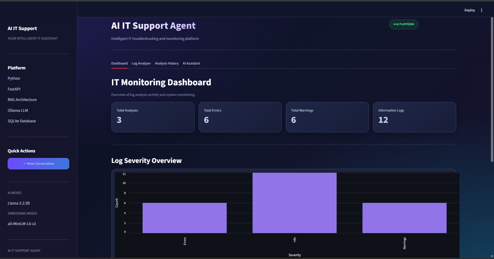
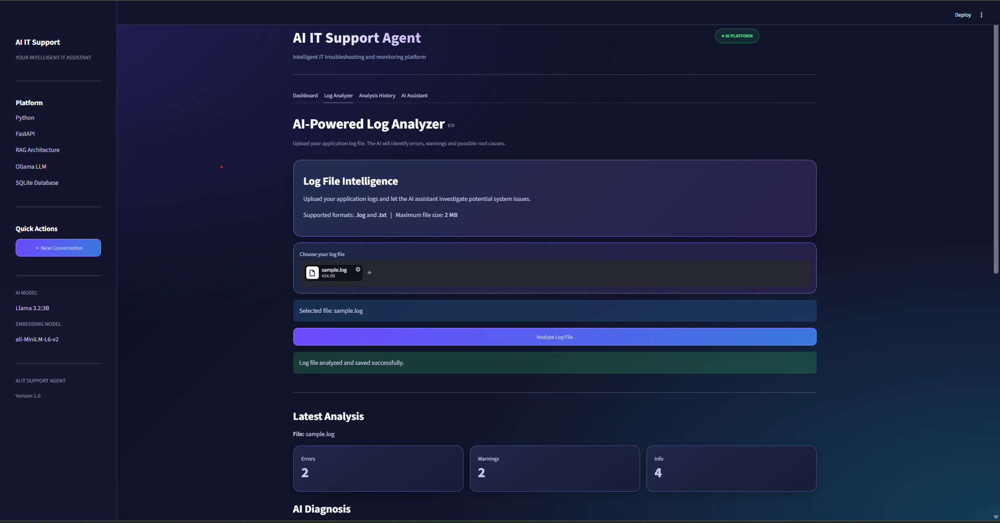
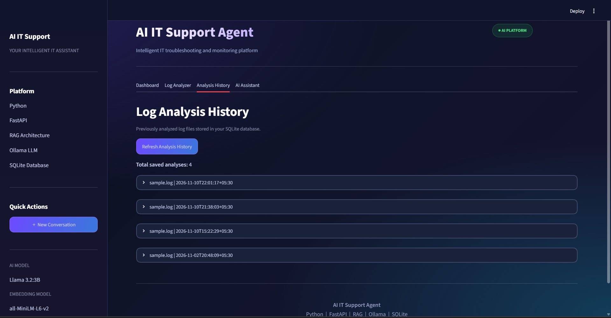
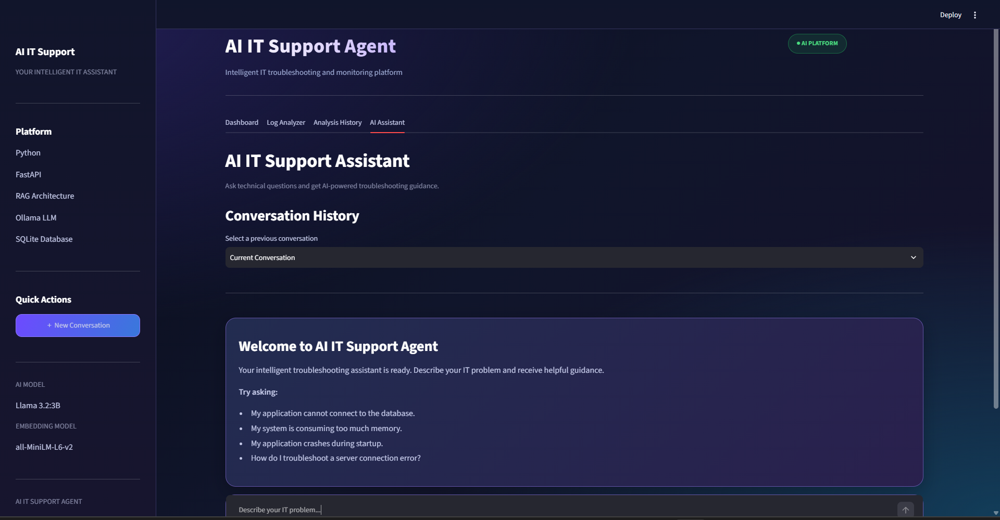

# AI-Powered IT Support Agent

An intelligent IT troubleshooting assistant that uses Retrieval-Augmented Generation (RAG) and Large Language Models (LLMs) to help users troubleshoot technical issues and analyze application log files.

## Project Overview

The AI IT Support Agent provides automated technical support by retrieving relevant information from a knowledge base and generating troubleshooting recommendations.

It also analyzes uploaded log files, identifies errors and warnings, and provides AI-generated explanations and recommendations.

## Features

- **AI Chat Assistant:** Answers IT-related troubleshooting questions.
- **RAG-Based Retrieval:** Retrieves relevant information from a technical knowledge base.
- **Log File Analyzer:** Uploads and analyzes `.log` and `.txt` files.
- **Error Detection:** Identifies ERROR, WARNING, and INFO messages.
- **AI-Powered Diagnosis:** Generates possible root causes and troubleshooting recommendations.
- **Conversation History:** Stores and retrieves previous conversations.
- **Analysis History:** Saves previous log analysis results.
- **Interactive Dashboard:** Displays analysis statistics and log severity charts.
- **SQLite Database:** Persists conversations and log analysis records.

## Technologies Used

| Category | Technologies |
|---|---|
| Backend | Python, FastAPI |
| Frontend | Streamlit |
| AI Model | Ollama, Llama 3.2:3B |
| RAG | Sentence Transformers |
| Embeddings | all-MiniLM-L6-v2 |
| Database | SQLite |
| API Testing | Swagger UI |
| Version Control | Git, GitHub |

## Project Architecture

1. User enters a technical question or uploads a log file.
2. FastAPI receives and processes the request.
3. The RAG component retrieves relevant knowledge-base information.
4. Ollama generates an AI-powered response.
5. SQLite stores conversations and log analysis results.
6. Streamlit displays the results through an interactive dashboard.

## Installation and Setup

### 1. Clone the repository

```bash
git clone YOUR_GITHUB_REPOSITORY_URL
cd YOUR_PROJECT_FOLDER
```

### 2. Create a virtual environment

```bash
python -m venv .venv
```

### 3. Activate the environment (Windows)

```cmd
.venv\Scripts\activate.bat
```

### 4. Install dependencies

```bash
pip install -r requirements.txt
```

### 5. Install and start Ollama

Download Ollama and pull the required model:

```bash
ollama pull llama3.2:3b
```

Make sure Ollama is running.

### 6. Start the FastAPI backend

```bash
python -m uvicorn src.api:app --reload
```

Backend URL:

`http://127.0.0.1:8000`

Swagger documentation:

`http://127.0.0.1:8000/docs`

### 7. Start the Streamlit frontend

Open another terminal:

```bash
.venv\Scripts\activate.bat
python -m streamlit run app.py
```

Frontend URL:

`http://localhost:8501`

## API Endpoints

| Method | Endpoint | Description |
|---|---|---|
| GET | `/` | API health check |
| POST | `/ask` | Ask IT troubleshooting questions |
| GET | `/history` | Retrieve conversation history |
| POST | `/analyze-log` | Upload and analyze log files |
| GET | `/log-history` | Retrieve previous log analyses |

## Future Enhancements

- Add user authentication and role-based access.
- Support additional log file formats.
- Improve retrieval accuracy.
- Add more technical knowledge-base documents.
- Deploy the application to a cloud platform.

## Project Screenshots

### 1. IT Monitoring Dashboard


### 2. Log Analyzer


### 3. Analysis History


### 4. AI Assistant


## Author

Developed as a personal project to explore AI-powered IT support, RAG, backend API development, and interactive dashboards.